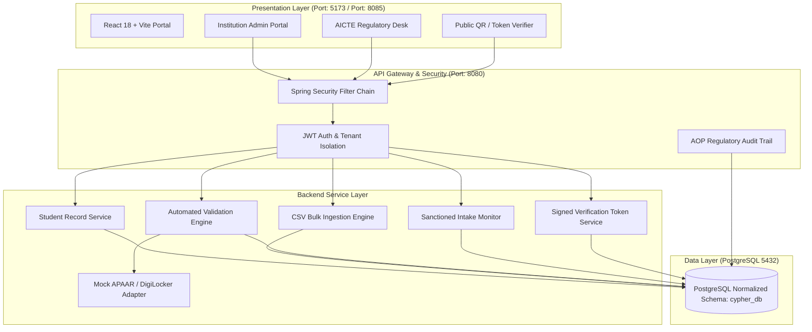

# CYPHER: AICTE Regulatory Officer & Student Data Management Platform

[](https://spring.io/projects/spring-boot)
[](https://openjdk.org/)
[](https://react.dev/)
[](https://vitejs.dev/)
[](https://www.postgresql.org/)
[](https://www.docker.com/)
[](https://tailwindcss.com/)

**CYPHER** is a secure, centralized full-stack student data management and verification platform engineered for **All India Council for Technical Education (AICTE)** approved institutions and regulatory authorities.

The platform provides:
1. **Student Data Management API & Ingestion Engine**: Add single records or bulk-ingest CSV rosters with real-time format validation.
2. **Automated Algorithmic Validation**: Verhoeff check-digit verification, 12-digit APAAR syntax checking, intra-institution duplicate detection, and cross-institution active dual enrolment detection.
3. **Institutional Intake Monitoring**: Live quota adherence tracking against AICTE approved limits (General, NRI, Supernumerary / TFW).
4. **Secure Public Verification**: Zero-PII, cryptographically signed, tamper-evident QR verification tokens.
5. **Role-Based Portals**: Dedicated AICTE Directorate Desk, College Administration Portal, and Public Credential Verifier.
6. **Regulatory Authentication Flow**: Dedicated Login view and a strict 5-field Staff Registration Desk with administrative approval verification gating.

---

## Architecture Diagram



---

## Repository Structure

```text
CYPHER/
├── docker-compose.yml           # Complete Docker orchestration (DB + Backend + Frontend)
├── run-local.bat                # Windows interactive 1-click launcher
├── run-local.sh                 # Linux / macOS / WSL 1-click launcher
├── serve.ps1                    # Lightweight local web server for standalone mode
├── index.html                   # Root entry point
├── CYPHER_App_Standalone.html   # Fully standalone client (opens instantly in any browser)
├── .gitignore                   # Standard Git ignore rules
├── README.md                    # Project documentation
│
├── database/                    # Database setup scripts & documentation
│   ├── init.sql                 # Combined PostgreSQL DDL + Seed Data
│   └── README.md                # PostgreSQL setup instructions
│
├── backend/                     # Spring Boot 3 Java 17+ Enterprise REST API
│   ├── Dockerfile               # Multi-stage container build
│   ├── pom.xml                  # Maven dependencies & plugins
│   └── src/main/
│       ├── java/com/aicte/apaarverify/
│       │   ├── config/          # Spring Security, JWT, OpenAPI Swagger
│       │   ├── controller/      # REST API Controllers (/api/v1/...)
│       │   ├── dto/             # Request & Response Data Transfer Objects
│       │   ├── model/           # Hibernate / JPA Entities
│       │   ├── repository/      # Spring Data JPA Repositories
│       │   ├── security/        # JWT Authentication Filter & Token Provider
│       │   └── service/         # Validation Engine, Intake Quota, Verhoeff
│       └── resources/
│           ├── application.yml  # Application properties & database connection
│           ├── schema.sql       # PostgreSQL DDL
│           └── data.sql         # Pre-seeded test records & users
│
├── frontend/                    # Modern React 18 + Vite + Tailwind CSS Application
│   ├── Dockerfile               # Node 20 container definition
│   ├── package.json             # NPM dependencies & scripts
│   ├── vite.config.js           # Vite dev proxy configuration
│   ├── tailwind.config.js       # Tailwind theme & color setup
│   ├── index.html               # Frontend HTML root
│   └── src/
│       ├── App.jsx              # Main UI with dedicated Login & 5-Field Registration
│       ├── main.jsx             # React DOM entry point
│       ├── index.css            # Tailwind directives
│       └── services/
│           ├── api.js           # API Client with mock fallbacks
│           └── mockData.js      # Pre-seeded client models
│
└── sample_data/
    ├── synthetic_students_dataset.csv       # Test student roster
    └── apaar_verify_postman_collection.json # Complete Postman API Collection
```

---

## How to Run on Localhost

You have **3 flexible options** to run CYPHER locally:

### Option 1: Docker Compose (Recommended Full-Stack)
Run everything (PostgreSQL database, Spring Boot API, and React Frontend) with a single command:

```bash
docker-compose up --build -d
```

* **Frontend Web Portal**: [http://localhost:5173](http://localhost:5173)
* **Backend REST API**: [http://localhost:8080/api/v1](http://localhost:8080/api/v1)
* **Swagger API Documentation**: [http://localhost:8080/swagger-ui.html](http://localhost:8080/swagger-ui.html)
* **PostgreSQL Database**: `localhost:5432` (Database: `cypher_db`, User: `postgres`, Pass: `postgres`)

To stop all services:
```bash
docker-compose down
```

---

### Option 2: Manual Development Run (Node.js + Java + PostgreSQL)

#### 1. Setup PostgreSQL Database
```bash
# Connect to PostgreSQL CLI
psql -U postgres

# Create the database and import schema + seed data
CREATE DATABASE cypher_db;
\c cypher_db;
\i database/init.sql
\q
```

#### 2. Start the Spring Boot Backend
```bash
cd backend
mvn clean spring-boot:run
```
* Backend starts at `http://localhost:8080`

#### 3. Start the React Frontend
```bash
cd frontend
npm install
npm run dev
```
* Frontend starts at `http://localhost:5173` (Vite dev proxy forwards `/api` requests to port `8080`)

---

### Option 3: Instant Zero-Install Standalone
If you need to demo the portal immediately without running Maven or Docker:
* Double-click **`CYPHER_App_Standalone.html`** or **`index.html`** in any web browser.
* Or run the lightweight server script in PowerShell:
  ```powershell
  .\serve.ps1
  ```
  And open **[http://localhost:8085](http://localhost:8085)**.

---

## Pre-Seeded Demonstration Accounts

| Role | Username / Staff ID | Password | Access Level |
| :--- | :--- | :--- | :--- |
| **AICTE Regulatory Director** | `aicte_officer` / `AICTE-HQ-001` | `password123` | National Headquarters (Full Directorate Oversight) |
| **College Admin / Registrar** | `diet_admin` / `DIET-REG-001` | `password123` | DIET Institutional Portal (Student Roster & Intake Quota) |
| **MNIT Institutional Admin** | `mnit_admin` / `MNIT-REG-002` | `password123` | MNIT Institutional Portal (Campus Admissions) |

> **Note on New Staff Registration**:  
> The Sign-Up page accepts **strictly five fields**: *Full Name*, *Staff Email ID*, *Staff ID*, *Department*, and *Password*. Newly self-registered accounts are created with `isApproved = false` and must be approved before receiving regulatory officer privileges.

---

## REST API Reference

| Method | Endpoint | Description | Auth Required |
| :--- | :--- | :--- | :--- |
| `POST` | `/api/v1/auth/register` | Register new regulatory staff (5 fields) | No |
| `POST` | `/api/v1/auth/login` | Authenticate officer & receive JWT | No |
| `GET` | `/api/v1/students` | Retrieve students (tenant filtered) | Yes |
| `POST` | `/api/v1/students` | Add single student record | Yes |
| `POST` | `/api/v1/students/bulk` | Ingest student CSV roster | Yes |
| `GET` | `/api/v1/validation/run` | Execute algorithmic anomaly detection | Yes |
| `GET` | `/api/v1/intake` | Get approved vs enrolled intake quota | Yes |
| `GET` | `/api/v1/verify/{token}` | Public tamper-evident QR verification | No |
| `GET` | `/api/v1/reports/roster` | Export master student roster PDF | Yes |
| `GET` | `/api/v1/reports/intake-audit`| Export sanctioned intake compliance PDF | Yes |
| `GET` | `/api/v1/audit-logs` | Retrieve immutable statutory audit trail | Yes |

*Full interactive API documentation is available via Swagger at `http://localhost:8080/swagger-ui.html`.*

---

## How to Push to GitHub

Follow these steps to upload this complete full-stack project to your GitHub account:

### Step 1: Create a New Repository on GitHub
1. Go to [github.com/new](https://github.com/new).
2. Set the repository name to `cypher` (or `cypher-aicte-portal`).
3. Set visibility to **Public** or **Private**.
4. **Do not** check "Initialize with README", `.gitignore`, or license (they are already included).
5. Click **Create repository**.

### Step 2: Push from Your Terminal
Open PowerShell or your terminal inside the project directory:

```bash
# 1. Initialize git repository (if not already initialized)
git init

# 2. Add all files to staging
git add .

# 3. Create your first commit
git commit -m "feat: Initial commit of CYPHER AICTE Full-Stack Regulatory Platform"

# 4. Set default branch to main
git branch -M main

# 5. Link your GitHub repository (replace with your GitHub URL)
git remote add origin https://github.com/<YOUR-USERNAME>/<YOUR-REPOSITORY-NAME>.git

# 6. Push to GitHub
git push -u origin main
```

---

## Security & Data Privacy Compliance
* **Zero Aadhaar Collection**: In strict compliance with regulatory guidelines, Aadhaar numbers are never collected, stored, or processed.
* **Cryptographic Token Verification**: Verification credentials contain unpredictable, signed tokens (`tok_sec_...`). No personal student PII is encoded into QR codes.
* **Multi-Tenant Isolation**: Institution administrators cannot access or query student data from other institutions.
* **Distinction of Gateways**: Syntactic 12-digit format check is explicitly separated from authorized gateway verification.

---

## License
Developed for the All India Council for Technical Education (AICTE), Ministry of Education, Government of India.
